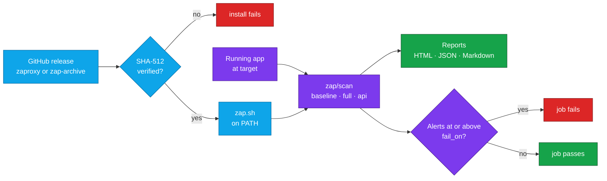

<div align="center">


# ZAP Scanner Orb for CircleCI

### Scan your running web app or API for vulnerabilities on every push.

Install [ZAP](https://www.zaproxy.org/), point it at the app your job starts, and fail the build at the risk level you choose<br>
with two steps of CircleCI config.<br>
Strict SHA-512 verification by default · No `sudo` · Reports stored even when the scan fails

[](https://circleci.com/gh/juburr/zap-scanner-orb)
[](https://circleci.com/developer/orbs/orb/juburr/zap-scanner-orb)
[](LICENSE)
[](https://discuss.circleci.com/c/ecosystem/orbs)


**[Quick Start](#-quick-start)** · **[Features](#-why-zap-scanner-orb)** · **[Recipes](#-recipes)** · **[Red Hat UBI](#-red-hat-ubi-images)** · **[Commands](#-commands)** · **[Security](#-secure-by-design)** · **[Troubleshooting](#-troubleshooting)**

<sub>An unofficial, community-maintained orb. [Contributions are welcome!](#-contributing)</sub>

</div>

<br>

## ✨ Why zap-scanner-orb?

<table>
<tr>
<td width="33%" valign="top">
🔎 <b>Three scans, no plan to write</b><br><br>
<code>baseline</code> spiders your app and reports passive alerts without attacking it. <code>full</code> adds an active scan, and <code>api</code> attacks every operation in an OpenAPI definition. The orb writes the Automation Framework plan, or runs <a href="#run-your-own-automation-framework-plan">your own</a>.
</td>
<td width="33%" valign="top">
🚦 <b>A gate you set</b><br><br>
<code>fail_on: medium</code> fails the job when any alert at or above that risk turns up, and <code>never</code> only reports. Silence a false positive by rule ID with <code>ignore_rules</code>. HTML, JSON and Markdown reports are stored as artifacts whether the scan passes or fails.
</td>
<td width="33%" valign="top">
🔑 <b>Authenticated scans that keep the token secret</b><br><br>
Pass the <i>name</i> of the variable holding your API key or bearer token. Its value never reaches the plan, the reports, the log or ZAP's command line, and by default the header only goes to the target's host. <a href="#authenticated-scans">More</a>
</td>
</tr>
<tr>
<td width="33%" valign="top">
🔐 <b>Verified installs, fail-closed by default</b><br><br>
Every ZAP release the ZAP project still hosts is pinned to a SHA-512 anchored to the checksum ZAP published, and versions the orb can't verify are refused, not installed. <a href="#-checksum-verification">Opt-outs</a> are explicit.
</td>
<td width="33%" valign="top">
☕ <b>Java checked up front</b><br><br>
<code>install</code> checks for Java before downloading anything, then checks its version against the minimum the ZAP release declares, so a mismatch fails the install with a fix, not your first scan.
</td>
<td width="33%" valign="top">
🧪 <b>Tested on the images you use</b><br><br>
CI installs and scans on <code>cimg/openjdk</code>, <a href="#-red-hat-ubi-images">Red Hat UBI 8 and 9</a> (including <code>ubi-minimal</code> and the OpenJDK images), machine executors, and amd64 and arm64 resource classes.
</td>
</tr>
</table>

### 🧩 The Orb vs. a Hand-Rolled Script

| | Scripting ZAP yourself | With the orb |
| --- | --- | --- |
| **Installing ZAP** | Find the release archive in zaproxy/zaproxy, or in zaproxy/zap-archive once it has moved there, and check it against the SHA-256 in the release notes | `zap/install` checks a pinned SHA-512, tries both locations, refuses unknown versions and caches the verified archive |
| **Java** | Find out at scan time that the launcher won't start on your Java | Checked before the download, then against the release's own minimum |
| **Waiting for the app** | Write a polling loop around `curl` | `wait_for_target_seconds`, 60 by default. Any HTTP response counts |
| **Writing the plan** | Author an Automation Framework plan with a context, spider, passive scan wait, active scan and three report jobs | `scan_type: baseline`, `full` or `api` |
| **Failing the build** | Parse `report.json` yourself, or use the `exitStatus` job, which needs ZAP 2.16.0 or newer | `fail_on`, from ZAP 2.12.0 on |
| **Authentication** | Export ZAP's `ZAP_AUTH_HEADER*` variables, and remember to restrict them to one site | `auth_header_value: MY_VAR`, scoped to the target's host, and a missing context fails the step instead of scanning unauthenticated |
| **Memory** | The JVM sizes its heap from the host's memory, which can get ZAP killed on smaller resource classes | An explicit heap: `max_memory`, `1g` by default |

## 🔄 How It Works



`zap/install` downloads ZAP's Linux release archive from the ZAP project's GitHub releases, verifies its SHA-512 checksum in the default `strict` mode shown here, extracts it and puts `zap.sh` on the `PATH`. See [Checksum Verification](#-checksum-verification) for the other modes. `zap/scan` waits for your app to respond, writes an Automation Framework plan for the scan type you chose, runs ZAP headless, and writes HTML, JSON and Markdown reports. The step fails when any alert type is at or above `fail_on`, and the reports are stored as artifacts either way.

## 🚀 Quick Start

Start your app as a service container, install ZAP, scan. Copy this into `.circleci/config.yml`:

```yaml
version: 2.1

orbs:
  zap: juburr/zap-scanner-orb@0

jobs:
  dast:
    docker:
      # ZAP needs Java, which cimg/openjdk includes.
      - image: cimg/openjdk:21.0
      # The application under test, reachable at localhost.
      - image: bkimminich/juice-shop:latest
    steps:
      - zap/install:
          version: "2.17.0"
      - zap/scan:
          target: http://localhost:3000
          fail_on: medium

workflows:
  security:
    jobs:
      - dast
```

Swap in your own app image and port, push, and the scan waits for the application to respond, spiders it, and fails the job if any passive scan alert is medium risk or higher. The HTML, JSON and Markdown reports are stored under `zap-reports/` in the job's **Artifacts** tab whether the scan passes or fails. Any Linux executor with Java and the tools listed under [Supported Platforms](#-supported-platforms) works; see [ZAP and Java Versions](#-zap-and-java-versions) for the Java each ZAP release needs, and [Red Hat UBI Images](#-red-hat-ubi-images) for images that don't include Java.

> [!TIP]
> Upgrading from `report_dir`, `extra_options` or `wait_for_target`? The next release renames them. See [Upgrading](#-upgrading).

> [!NOTE]
> Findings fail the job: `fail_on` defaults to `medium`. Set `fail_on: never` to only report alerts while you work through them, or [ignore false positives](#ignore-false-positives) by rule ID.

## 🔎 Scan Types

Set `scan_type` on `zap/scan`:

| `scan_type` | What it does | Attacks the target |
| --- | --- | --- |
| `baseline` *(default)* | Spiders `target`, then reports passive scan alerts. | No |
| `full` | As `baseline`, then runs an active scan. | Yes |
| `api` | Imports `api_definition` (OpenAPI), then runs an active scan. | Yes |

`baseline` is safe to run on every commit. `spider_minutes` limits the spider (1 minute by default) and `active_scan_minutes` the active scan (10 minutes by default); `0` removes either limit. Scanning needs ZAP 2.12.0 or newer. To run something else, such as a scan with a login form, give `plan` [your own Automation Framework plan](#run-your-own-automation-framework-plan).

> [!WARNING]
> Only run `full` and `api` scans against applications you are authorized to test, ideally one started in the same job as a service container or background step.

## 📊 Reports and Results

`output_dir` (default `/tmp/zap-reports`) receives `report.html`, `report.json` and `report.md`, along with the generated `plan.yaml` and ZAP's `zap.log`. These files are replaced if an earlier scan wrote them, but other files in the directory are left alone. Give each scan in a job its own `output_dir` to keep all of their reports. With `store_artifacts: true` (the default), the directory is stored as artifacts under `zap-reports/`, including when the scan fails.

The step prints the number of alerts at each risk level, and fails if any alert is at or above `fail_on`. It also fails if ZAP reports a plan error, such as the target refusing connections. Alerts are counted by type, so one missing header on 50 pages is one alert. To find an alert's details, open `report.html` from the job's **Artifacts** tab.

A [custom plan](#run-your-own-automation-framework-plan) writes whichever reports it defines; the step adds only `zap.log`, and the plan sets its own pass/fail criteria.

## 🍳 Recipes

### Scan an API From Its OpenAPI Definition

Import the definition from your repository and actively scan every operation it describes, against an API started earlier in the job:

```yaml
jobs:
  api-dast:
    docker:
      - image: cimg/openjdk:21.0
    steps:
      - checkout
      - zap/install
      - run:
          name: Start the API
          command: ./scripts/start-api.sh
          background: true
      - zap/scan:
          scan_type: api
          target: http://localhost:8080
          api_definition: openapi.yaml
          fail_on: high
          active_scan_minutes: 20
```

`api` scans send every operation in `api_definition` to `target`, never to the definition's `servers`. A relative server such as `/` therefore resolves against `target`, and a production URL in `servers` is never scanned. When `api_definition` is a URL, ZAP only fetches the definition from that host. A path in `target` replaces the server's path, and a lone trailing `/` counts as a path. For example, with `servers: [{url: /v1}]`, a `target` of `http://localhost:8080` scans `/v1/...`, but `http://localhost:8080/` scans the operations at the root. Custom plans must set `targetUrl` on their `openapi` job to get this behavior. Without it, ZAP fails to import a definition file whose servers are relative, and resolves the servers of a definition fetched from a URL against the host that served it.

### Run a Full Active Scan

A `full` scan spiders the app like `baseline`, then runs an active scan, which sends attacks to the pages the spider found:

```yaml
- zap/scan:
    target: http://localhost:3000
    scan_type: full
    active_scan_minutes: 20
    # How long the scan may run without printing output before CircleCI stops it.
    no_output_timeout: 45m
```

Raise `max_memory` (`1g` by default) or use a larger `resource_class` if ZAP runs out of memory on a large app.

### Ignore False Positives

Set `ignore_rules` to the IDs of scan rules that don't apply to your application, separated by commas or whitespace. Each alert's rule ID is the "Plugin Id" in `report.html` and `pluginid` in `report.json`, and all of them are listed in ZAP's [alert reference](https://www.zaproxy.org/docs/alerts/).

```yaml
- zap/scan:
    target: http://localhost:8080
    fail_on: medium
    # 10020 Missing Anti-clickjacking Header and 10038 CSP Header Not Set: both
    # headers are added by the reverse proxy in production, which CI scans bypass.
    ignore_rules: "10020, 10038"
```

ZAP marks these rules' alerts as false positives with an [alert filter](https://www.zaproxy.org/docs/desktop/addons/alert-filters/), and they're left out of the reports and the `fail_on` check. The rules still run, and a rule is ignored on every URL. To ignore a rule only on some URLs, parameters, or evidence, or to ignore just one alert variant such as `10038-1`, add an `alertFilter` job to a custom plan. Leave a comment next to `ignore_rules` explaining each rule, so they can be revisited later.

### Authenticated Scans

If the application accepts a token in a header, such as an API key or a bearer token, store it in a [context](https://circleci.com/docs/contexts/) or project environment variable and pass that variable's name as `auth_header_value`:

```yaml
- zap/scan:
    target: http://localhost:8080
    auth_header: X-Api-Key          # Default: Authorization
    auth_header_value: DAST_API_KEY # The value might be "Bearer <token>" for Authorization
```

```yaml
workflows:
  security:
    jobs:
      - api-dast:
          # Provides the DAST_API_KEY environment variable.
          context: dast-credentials
```

ZAP then adds the header to every request it makes to `auth_header_site`, including the spider, the active scan, and fetching an `api_definition` URL. This uses ZAP's [authentication environment variables](https://www.zaproxy.org/docs/getting-further/authentication/handling-auth-yourself/), so it also works with custom plans. Setting `ZAP_AUTH_HEADER_VALUE`, `ZAP_AUTH_HEADER`, or `ZAP_AUTH_HEADER_SITE` in a context works too, and the parameters take precedence over them.

- The value is never printed, and never written to the plan, the reports, or ZAP's command line. Only the ZAP process receives it, in its environment.
- `auth_header_site` defaults to the host of `target`, so the header isn't sent to other hosts the scan reaches, such as the host serving an `api_definition` URL. ZAP matches any site whose name contains the value, so `example.com` also matches `api.example.com`. A custom plan without a `target` must set `auth_header_site`.
- If `auth_header_value` names a variable other than the default and it is empty, the step fails rather than silently scanning without authentication. This happens, for example, when a context isn't attached to the job, or for a pull request from a fork.
- The token must stay valid for the whole scan. For login forms or tokens that expire, configure authentication in a custom plan instead.

### Run Your Own Automation Framework Plan

Set `plan` to run your own [Automation Framework](https://www.zaproxy.org/docs/automate/automation-framework/) plan, for example one with authentication configured, exported from the ZAP desktop app. The plan can reference `${ZAP_TARGET}` and `${ZAP_REPORT_DIR}`, which are set from `target` and `output_dir`.

```yaml
- zap/scan:
    plan: .zap/plan.yaml
    target: http://localhost:3000
    max_memory: 2g
```

`fail_on`, `ignore_rules`, `scan_type`, and the time limits don't apply to custom plans, so end the plan with an `exitStatus` job (ZAP 2.16.0 or newer) to fail on alerts:

```yaml
# .zap/plan.yaml
env:
  contexts:
    - name: target
      urls:
        - ${ZAP_TARGET}
  parameters:
    failOnError: true
jobs:
  - type: spider
    parameters:
      context: target
  - type: passiveScan-wait
  - type: report
    parameters:
      template: traditional-html
      reportDir: ${ZAP_REPORT_DIR}
      reportFile: report.html
  - type: exitStatus
    parameters:
      errorLevel: Medium   # exit code 1: the step fails
      warnLevel: Low       # exit code 2: the step passes with a warning
```

The step fails when ZAP exits with a plan error (exit code 1), and passes with a warning on plan warnings (exit code 2).

### Machine Executors and `JAVA_HOME`

From ZAP 2.17.0 onward, both `install` and `zap.sh` honor `JAVA_HOME`, so Java doesn't have to be on the `PATH`, for example on a machine executor where an earlier step downloads a Java runtime, as CI does with Eclipse Temurin (which needs access to `api.adoptium.net` and GitHub):

```yaml
jobs:
  dast:
    machine:
      image: ubuntu-2404:current
    steps:
      - checkout
      - run:
          name: Download a Temurin 21 JRE into JAVA_HOME
          command: |
            case "$(uname -m)" in
              x86_64) arch=x64 ;;
              aarch64) arch=aarch64 ;;
            esac
            mkdir -p "$HOME/temurin21"
            curl -fsSL --retry 5 "https://api.adoptium.net/v3/binary/latest/21/ga/linux/${arch}/jre/hotspot/normal/eclipse" \
              | tar -xz -C "$HOME/temurin21" --strip-components=1
            echo "export JAVA_HOME=\"$HOME/temurin21\"" >> "$BASH_ENV"
      - zap/install:
          install_path: $HOME/tools/zap
      - run:
          name: Log ZAP Version
          command: zap.sh -cmd -version
```

## ☕ ZAP and Java Versions

ZAP's Linux release does not bundle a Java runtime. The `cimg/openjdk` images work out of the box, and [Red Hat UBI images](#-red-hat-ubi-images) need Java installed first. From ZAP 2.17.0 onward, `JAVA_HOME` is honored when set. Earlier releases' launchers ignore `JAVA_HOME` and require `java` on the `PATH`, and the orb checks whichever Java the release will actually use. The `install` command checks for Java before downloading anything, then checks the version against the minimum declared by the ZAP release being installed.

Every ZAP release still hosted by the ZAP project has a pinned checksum, so it installs with the default `verify_checksums: strict`:

| ZAP version | Java | Executor example | Red Hat UBI 8 package |
| --- | --- | --- | --- |
| 2.16.0 – 2.17.0 | 17 or newer | `cimg/openjdk:21.0` | `java-21-openjdk-headless` |
| 2.12.0 – 2.15.0 | 11 or newer | `cimg/openjdk:21.0` | `java-21-openjdk-headless` |
| 2.7.0 – 2.11.1 | 8 or newer | `cimg/openjdk:21.0` | `java-21-openjdk-headless` |
| 2.4.0, 2.4.2, 2.4.3, 2.5.0 | 7 or 8 only | `cimg/openjdk:8.0` | `java-1.8.0-openjdk-headless` |

The `scan` command requires ZAP 2.12.0 or newer.

ZAP 2.0.0 through 2.3.1, 2.4.1, and 2.6.0 are no longer hosted anywhere by the ZAP project and cannot be installed. Releases older than the most recent one are downloaded from [zaproxy/zap-archive](https://github.com/zaproxy/zap-archive) once the ZAP project moves them there. The ZAP project only supports its latest release, and older releases may contain known vulnerabilities, so the command warns when installing anything else.

## 🎩 Red Hat UBI Images

The orb runs on Red Hat [Universal Base Images](https://catalog.redhat.com/software/base-images) (UBI) 8 and 9. Unlike `cimg/openjdk`, these images lack some of what the orb needs, so install the missing packages from the UBI repositories in a step before `install`.

| Image | Missing | Setup step |
| --- | --- | --- |
| `ubi8/ubi`, `ubi9/ubi` | Java | `dnf install -y java-21-openjdk-headless` |
| `ubi8/ubi-minimal`, `ubi9/ubi-minimal` | Java, `tar`, `gzip` | `microdnf install -y tar gzip java-21-openjdk-headless` |
| `ubi8/openjdk-17`, `ubi8/openjdk-21`, `ubi9/openjdk-17`, `ubi9/openjdk-21`, and their `-runtime` variants | `gzip` | `microdnf install -y gzip`, as root (see below) |

The headless Java packages are enough for scans, including their HTML reports. See [ZAP and Java Versions](#-zap-and-java-versions) for the package to use with older ZAP releases.

```yaml
jobs:
  dast:
    docker:
      - image: registry.access.redhat.com/ubi8/ubi:latest
      - image: bkimminich/juice-shop:latest
    steps:
      - run:
          name: Install Java
          command: dnf install -y java-21-openjdk-headless
      - zap/install
      - zap/scan:
          target: http://localhost:3000
```

**Red Hat's OpenJDK images.** The `ubi8/openjdk-*` and `ubi9/openjdk-*` images include Java, but not `gzip`, and they run as a non-root user (uid 185) that can't install packages. Either run the job as root to install it:

```yaml
    docker:
      - image: registry.access.redhat.com/ubi8/openjdk-21:latest
        user: root
    steps:
      - run:
          name: Install gzip
          command: microdnf install -y gzip
      - zap/install
```

Or, to keep the job unprivileged, build your own image with `gzip` added and run it as uid 185:

```dockerfile
FROM registry.access.redhat.com/ubi8/openjdk-21:latest
USER root
RUN microdnf install -y gzip && microdnf clean all
USER 185
```

Either way, ZAP is installed under the image's `$HOME` (`/home/jboss` on UBI 8, `/home/default` on UBI 9). A custom image also saves installing packages in every job, so it suits any of the images above.

**Checking out code.** UBI images don't include `git` or `ssh`. If the job runs `checkout`, install them first with `dnf install -y git-core openssh-clients` (`microdnf` on the minimal and OpenJDK images).

**Several Java versions.** When more than one Java package is installed, RHEL's `alternatives` system picks the `java` on the `PATH`, and it may not be the newest: with Java 8 and Java 21 both installed, it picks Java 8. For ZAP 2.17.0 and newer, point `JAVA_HOME` at the Java to use:

```yaml
      - run:
          name: Use Java 21 for ZAP
          command: echo 'export JAVA_HOME=/usr/lib/jvm/jre-21' >> "$BASH_ENV"
```

Earlier releases ignore `JAVA_HOME`, so switch the system default instead, as root:

```bash
alternatives --set java "$(readlink -f /usr/lib/jvm/jre-21/bin/java)"
```

## 🧰 Commands

### `zap/install`

Downloads the `ZAP_<version>_Linux.tar.gz` release archive, verifies it, extracts it to `install_path`, and symlinks `zap.sh` into `bin_path`. If `bin_path` is not already on the `PATH`, it is added for subsequent steps, and `ZAP_INSTALL_PATH` and `ZAP_VERSION` are exported to subsequent steps too. It checks the executor's Java first; see [ZAP and Java Versions](#-zap-and-java-versions). Run it before `scan`, in the same job. Needs bash 4 or newer.

| Parameter | Default | Description |
| --- | --- | --- |
| `version` | `2.17.0` | ZAP release to install, such as `2.17.0`; a leading `v` is ignored. Values that aren't a release version, such as `latest`, are rejected. |
| `install_path` | `$HOME/zap` | Absolute path of the directory to extract ZAP into. It must not exist or must be empty. |
| `bin_path` | `$HOME/bin` | Absolute path of the directory for the `zap.sh` symlink, added to the `PATH` of later steps when it isn't already on it. |
| `verify_checksums` | `strict` | `strict`, `known_versions` or `false`. See [Checksum Verification](#-checksum-verification). |
| `caching` | `true` | Cache the release archive between jobs, keyed by version, CPU architecture and home directory. Only verified archives are cached, and a cached archive is verified again before it is used. |

**Re-running.** Invoking `install` again with the same `install_path` and `version` is a no-op, so it is safe to call from multiple reusable commands in one job. Installing into a non-empty directory that this orb did not create, or over a different version, fails without touching the existing files. So does a verified install over one made with `verify_checksums: false` whose archive doesn't match the checksum.

**Atomicity.** ZAP is extracted into a staging directory beside `install_path` and only moved into place once it has been verified, so a failed install never leaves a partially populated directory.

Environment variables are expanded in `version`, `install_path` and `bin_path`, and a leading `~/` in `install_path` and `bin_path`. Neither path can contain `:`.

### `zap/scan`

Runs a headless scan with ZAP's [Automation Framework](https://www.zaproxy.org/docs/automate/automation-framework/) and stores the reports as artifacts. It generates a [`baseline`, `full` or `api`](#-scan-types) plan, or runs your own. Run `install` earlier in the same job; scanning requires ZAP 2.12.0 or newer.

| Parameter | Default | Description |
| --- | --- | --- |
| `target` | *(empty)* | URL to scan, such as `http://localhost:8080`. Required unless `plan` is set. |
| `scan_type` | `baseline` | `baseline`, `full` or `api`. See [Scan Types](#-scan-types). Ignored when `plan` is set. |
| `api_definition` | *(empty)* | Path or `http(s)` URL of an OpenAPI definition, for `api` scans. Its operations are scanned on `target`; see [Scan an API](#scan-an-api-from-its-openapi-definition). |
| `plan` | *(empty)* | Path to a custom Automation Framework plan to run instead. See [Run Your Own Plan](#run-your-own-automation-framework-plan). |
| `fail_on` | `medium` | Fail on alerts at or above `high`, `medium`, `low` or `info`, or `never` to only report. Ignored when `plan` is set. |
| `ignore_rules` | *(empty)* | Scan rule IDs to treat as false positives, separated by commas or whitespace, such as `10020, 10038`. See [Ignore False Positives](#ignore-false-positives). Ignored when `plan` is set. |
| `spider_minutes` | `1` | Spider time limit for `baseline` and `full` scans, or `0` for none. |
| `active_scan_minutes` | `10` | Active scan time limit for `full` and `api` scans, or `0` for none. |
| `auth_header_value` | `ZAP_AUTH_HEADER_VALUE` | *Name* of the environment variable holding the header value. See [Authenticated Scans](#authenticated-scans). |
| `auth_header` | `$ZAP_AUTH_HEADER`, else `Authorization` | Header that carries the value. |
| `auth_header_site` | `$ZAP_AUTH_HEADER_SITE`, else the host of `target` | Only send the header to sites whose name contains this. Required for custom plans without a `target`. |
| `wait_for_target_seconds` | `60` | Seconds to wait for `target` to respond before scanning, or `0` to skip. Any HTTP response counts. |
| `max_memory` | `1g` | Maximum Java heap size for ZAP, such as `512m` or `2g`. |
| `output_dir` | `/tmp/zap-reports` | Absolute directory for the reports, plan, and ZAP log. Custom plans see it as `$ZAP_REPORT_DIR`. See [Reports and Results](#-reports-and-results). |
| `store_artifacts` | `true` | Store `output_dir` as artifacts under `zap-reports/`, including when the scan fails. |
| `extra_args` | *(empty)* | Extra arguments passed to `zap.sh` before `-autorun`, such as `-config connection.timeoutInSecs=60`. Split on whitespace, so individual arguments can't contain spaces. |
| `no_output_timeout` | `30m` | How long the scan may run silently before CircleCI stops it. |

**Isolation.** Each scan uses a fresh, temporary ZAP home directory rather than `~/.ZAP`, and an explicit heap size. Without one, the JVM sizes its heap from the host's memory rather than the container's limit, which can get ZAP killed on smaller resource classes. Passive scanning runs single-threaded (`-config pscans.threads=1`), because with more threads ZAP 2.17.0 intermittently drops alerts from the reports and the `fail_on` check; `extra_args` come after it, so they can override it.

Environment variables are expanded in `target`, `api_definition`, `plan`, `auth_header`, `auth_header_site` and `extra_args`. `output_dir` is passed to `store_artifacts` as is, so it must be a literal path.

## 📦 Upgrading

The next release renames three `scan` parameters. Update your config as follows:

| Old | New |
| --- | --- |
| `scan.report_dir` | `scan.output_dir` |
| `scan.extra_options` | `scan.extra_args` |
| `scan.wait_for_target` | `scan.wait_for_target_seconds` |

Custom plans keep using `${ZAP_REPORT_DIR}`, which is set from `output_dir`.

Behavior changes:
- The reports are now also stored as artifacts when the scan fails, as documented; previously the artifact step only ran after a passing scan.
- The scan's `ERROR:` and `WARN:` messages now go to stderr, so a step that captures its stdout and searches it for them must capture stderr too (`2>&1`).
- `install` defaults `verify_checksums` to `strict` instead of `known_versions`, so a ZAP version missing from the orb's checksum table fails before anything is downloaded. See [Checksum Verification](#-checksum-verification).
- `install` needs bash 4 or newer and accepts only release versions such as `2.17.0`. It caches the archive under `~/.cache/zap-scanner-orb` with a new cache key, so the first run after upgrading downloads ZAP again.

## 🔒 Secure by Design

- **Least Privilege**: Installs to user-owned directories by default, with no `sudo` usage anywhere in this orb.
- **Integrity**: Checksum validation of all downloaded release archives using SHA-512, anchored to the checksums ZAP publishes with each release. Versions without a pinned checksum fail closed by default, cached archives are re-verified on every restore, and a failed install never leaves a partly extracted directory. See [Checksum Verification](#-checksum-verification).
- **Provenance**: Installs directly from ZAP's official [releases page](https://github.com/zaproxy/zaproxy/releases/) on GitHub, or from the ZAP project's [zap-archive](https://github.com/zaproxy/zap-archive/releases) for older releases it has moved there. No third-party websites, domains, or proxies are used.
- **Confidentiality**: All secrets and environment variables are handled in accordance with CircleCI's [security recommendations](https://circleci.com/docs/security-recommendations/) and [best practices](https://circleci.com/docs/orbs-best-practices/). `auth_header_value` takes the *name* of an environment variable, and the value is never printed (even when the job traces its steps), never written to the plan, the reports or the log, and never put on ZAP's command line.
- **Isolation**: Each scan runs ZAP with a fresh temporary home directory, removed when the step exits, and sends the authentication header only to `auth_header_site`.
- **Privacy**: No usage data of any kind is collected or shipped back to the orb developer. Scans run ZAP with `-silent`, so ZAP itself makes no unsolicited requests, such as update checks or telemetry, to its own services.

> [!IMPORTANT]
> **Info for security teams:** see [Network Access](#-network-access) for the hosts to allow on locked-down or self-hosted runners.

## 💻 Supported Platforms

Linux executors, Docker or machine. ZAP's Linux release is one Java archive for every CPU, so `install` downloads the same file on any architecture (it logs the platform as `noarch`) and verifies it against a single SHA-512 per ZAP version. CI installs and scans on `x86_64` (amd64) and `aarch64` (arm64), including CircleCI [Arm resource classes](https://circleci.com/docs/using-arm/). Non-Linux executors fail the install before anything is downloaded.

The executor needs:
- A Java runtime compatible with the ZAP version. See [ZAP and Java Versions](#-zap-and-java-versions).
- bash 4 or newer. Images with only `/bin/sh`, and macOS's bash 3, are refused with a clear error.
- `curl` or `wget`, `awk`, `tar`, `gzip`, and the standard coreutils, including `mktemp`, `sort`, `cut` and, when verifying, `sha512sum`. `cimg/openjdk` has them all; on UBI images, see [Red Hat UBI Images](#-red-hat-ubi-images).

Images that run as root without `/home/circleci`, such as `eclipse-temurin`, work too: the default paths follow `$HOME`. Without the CircleCI CLI on the image, parameter values are used as written, without environment variable expansion.

The archive is cached under `~/.cache/zap-scanner-orb`, with a key made of the version, the CPU architecture (`uname -m`) and the home directory (`zap-scanner-orb-v1-<version>-…`), since a cache is restored to the absolute path it was saved from. Only verified archives are cached, and a restored archive is verified again before it is used. If a cached archive no longer matches its checksum, it is discarded and downloaded again rather than failing the build. On executors whose `PATH` doesn't already include `bin_path` (for example, machine executors), `install` adds it for later steps through `BASH_ENV`.

## 🔐 Checksum Verification

The `install` command checks the downloaded ZAP release archive against a SHA-512 lookup table built into the orb, with one entry per ZAP version. The `verify_checksums` parameter controls what happens:

| Value | Version in the orb's table | Version not in the table |
| --- | --- | --- |
| `strict` (default) | ✅ Verified; install fails on mismatch | ⛔ Install fails before anything is downloaded |
| `known_versions` | ✅ Verified; install fails on mismatch | ⚠️ Installed **unverified**, with a warning |
| `false` | ⚠️ Not verified | ⚠️ Installed **unverified** |

Every supported version has a pinned SHA-512 checksum. Each one was derived from a download that matched the checksum the ZAP project published for that release (SHA-256 for 2.8.0 and newer, SHA-1 for older releases), as recorded in [`src/scripts/upstream_checksums.txt`](src/scripts/upstream_checksums.txt), and CI re-derives the whole table from that file on every build. The one exception is 2.8.1, a Kali-only bug fix release for which the ZAP project never published a checksum; it is pinned to the archive the ZAP project serves on GitHub.

If you pin a ZAP release newer than this orb, `strict` fails until the orb is upgraded to pin it. Upgrade the orb (or open a PR adding the checksum, generated with `src/scripts/install_hash.sh`) rather than opting out. `known_versions` and `false` remain available for cases where you accept running an unverified release.

> [!WARNING]
> **Changed in the next release:** the default was previously `known_versions`, which installed unlisted versions without verification. Pipelines that pin a ZAP version newer than the orb's table now fail until they upgrade the orb or set `verify_checksums: known_versions` explicitly.

## 🌐 Network Access

Hosts to allow (HTTPS, port 443) when running on a locked-down or self-hosted runner:

| Host | Needed by | Purpose |
| --- | --- | --- |
| `github.com` | `install` | ZAP release download from [zaproxy/zaproxy](https://github.com/zaproxy/zaproxy/releases), or from [zaproxy/zap-archive](https://github.com/zaproxy/zap-archive/releases) for older releases |
| `release-assets.githubusercontent.com` | `install` | Where GitHub redirects release downloads |
| `objects.githubusercontent.com` | `install` | GitHub's previous redirect target for release downloads; allow it as well so a change on GitHub's side doesn't break downloads |
| The host in `target` | `scan` | The wait for the target to respond, and the scan itself, over whichever scheme and port `target` uses |
| The host in an `api_definition` URL | `scan` with `scan_type: api` | Fetching the definition. Nothing else is sent to it |

Scans only contact the target, plus the `api_definition` URL if one is given. They run ZAP with `-silent`, so ZAP makes no update checks or telemetry requests, and every add-on the generated plans use is bundled with the ZAP release, so nothing is downloaded at scan time. A custom plan reaches whatever hosts it names. Installing Java or other prerequisites in your own steps, such as with `dnf` on UBI, needs access to those package repositories.

## 🩺 Troubleshooting

| Error | Resolution |
| --- | --- |
| `Installing ZAP needs bash 4 or newer` | Use an executor image that has bash 4 or newer. |
| `no java executable was found` | Use a `cimg/openjdk` image, install Java in an earlier step (see [Red Hat UBI Images](#-red-hat-ubi-images)), or set `JAVA_HOME` (ZAP 2.17.0+). |
| `Installing ZAP needs '...', which is not available` | Install the package the error names in an earlier step. On UBI images, see [Red Hat UBI Images](#-red-hat-ubi-images). |
| `Neither curl nor wget is available` | Install either one in an earlier step. |
| `ignores JAVA_HOME, so java must be on the PATH` | Add `$JAVA_HOME/bin` to the `PATH` for ZAP releases before 2.17.0. |
| `requires Java ... or newer, but found Java ...` | Upgrade the executor's Java, or point `JAVA_HOME` at a newer runtime. On UBI, check which Java `alternatives` selected. |
| `only runs on Java 7 or 8` | Use `cimg/openjdk:8.0` for ZAP 2.5.0 and older, or pick a newer ZAP. |
| `Could not download ZAP ...` | After a 404, the version was never released, or is no longer hosted by the ZAP project. After 5xx errors, GitHub was unavailable for several minutes, so re-run the job. |
| `This orb has no checksum for ZAP ...` | Upgrade the orb once it pins the release, or temporarily set `verify_checksums: known_versions` to install it unverified. |
| `... already exists and is not empty` | Choose a different `install_path`, or remove the directory first. |
| `... holds a ZAP ... install whose archive doesn't match this orb's checksum` | Remove the directory, or choose a different `install_path`. |
| `zap.sh was not found on the PATH` | Run `install` earlier in the same job as `scan`. |
| `Scanning requires ZAP 2.12.0 or newer` | Install ZAP 2.12.0 or newer in the scanning job. |
| `... did not respond within ...s` | Check that the application started and listens on the `target` host and port, or raise `wait_for_target_seconds`. |
| `auth_header_value names $..., which is unset or empty` | Attach the context that defines the variable to the job, or check its name. |
| Authenticated pages are missing from the reports | Check that `auth_header_site` matches the host in `target`, and that the token hasn't expired. |
| `alert type(s) at or above fail_on` | Review `report.html` in the job's artifacts, then fix the findings, add false positives to `ignore_rules`, or raise `fail_on`. |
| `Invalid rule '...' in ignore_rules` | Use numeric rule IDs such as `10020`. For alert references such as `10038-1`, use an `alertFilter` job in a custom plan. |
| `ZAP scan failed (exit code 1)` | Look for "Automation plan failures" in the output. The target may be unreachable. |
| ZAP is killed, or runs out of memory | Raise `max_memory`, or use a larger `resource_class`. |
| `Too long with no output` | Raise `no_output_timeout`, or lower `active_scan_minutes`. |

## 🤝 Contributing

This is an unofficial, community-maintained orb, and contributions are welcome! Bug reports, feature ideas and pull requests all help.

- **Found a bug or have an idea?** [Open an issue](https://github.com/juburr/zap-scanner-orb/issues).
- **Need a newer ZAP release?** Generate its checksum with `src/scripts/install_hash.sh -v <version>`, paste it into the `sha512sums` table in [`src/scripts/install.sh`](src/scripts/install.sh), and open a pull request. The script checks the release archive against the SHA-256 checksum ZAP publishes in the GitHub release notes; see [Adding a New ZAP Version](#adding-a-new-zap-version) for the rest of the checklist.
- **Before opening a pull request**, run the checks CI runs first. The tests run offline, and the install and scan script tests under [Testing](#testing) need Java; `circleci orb validate` checks the packed orb against the CircleCI API, so it needs network access.

  ```bash
  yamllint .
  shellcheck src/scripts/*.sh .circleci/scripts/*.sh
  bash .circleci/scripts/install_test.sh
  bash .circleci/scripts/env_subst_tests.sh
  bash .circleci/scripts/shell_conventions_test.sh
  circleci orb pack src > orb.yml && circleci orb validate orb.yml
  ```

### Adding a New ZAP Version

```bash
bash src/scripts/install_hash.sh -v 2.18.0
```

This downloads the release archive, checks it against the SHA-256 checksum ZAP publishes in the GitHub release notes, and prints the SHA-512 entry to add to the table in `src/scripts/install.sh`. Set `GITHUB_TOKEN` to avoid GitHub API rate limits. Pass `-c SHA-256:<hex>` to also check against a checksum from another official source, such as the `<linux>` entry in [ZapVersions.xml](https://raw.githubusercontent.com/zaproxy/zap-admin/master/ZapVersions.xml).

Then:

1. Add the published checksum to `src/scripts/upstream_checksums.txt`.
2. Add the version to the test matrix for the oldest Java it supports in `.circleci/test-deploy.yml`. Don't rely on the "minimum of Java" line in `zap.sh` alone: ZAP 2.16.0's launcher declares Java 11 but its classes require Java 17. Confirm with the class file version of `org/zaproxy/zap/ZAP.class` in `zap-<version>.jar` (major version minus 44), and add a `zap_min_java_overrides` entry in `install.sh` if they disagree.
3. When bumping the default `version`, move the previous default into the appropriate matrix.

CI fails if any of these are missing or disagree.

### Testing

The `lint-pack` workflow in `.circleci/config.yml` runs orb-tools' lint, pack and review, shellcheck, and three offline tests: the install contract test shared by the juburr orbs (`install_test.sh`), the check that scripts pass parameter values to `circleci env subst` on stdin (`env_subst_tests.sh`), and the shared shell conventions check (`shell_conventions_test.sh`).

Every push then runs the following in `.circleci/test-deploy.yml`, and publishing requires all of them to pass:

- The `install` command on `cimg/openjdk` 17, 21, and 25, on both amd64 and arm64, plus every older pinned ZAP version on the oldest Java it supports.
- A headless ZAP daemon started from the install and queried over its API.
- Machine executors on amd64 and arm64 with Java reachable only via `JAVA_HOME`.
- A stock `eclipse-temurin` image running as root, without `/home/circleci`.
- Red Hat UBI 8 and 9 images set up as described in [Red Hat UBI Images](#-red-hat-ubi-images), each installing ZAP and scanning an nginx service container: `ubi` with Java 11, 17, and 21 (21 on both amd64 and arm64), `ubi-minimal`, and the `openjdk` images run as root. Also Java 8 installed alongside Java 21, with 21 selected by `JAVA_HOME` or by `alternatives`, and an install of ZAP 2.5.0 on UBI's Java 8.
- Paths containing spaces and environment variables, with caching disabled.
- Repeated invocation in one job, and a cache save/restore round trip.
- `.circleci/scripts/install_script_tests.sh`, which runs the install script directly against malformed input, missing tools, old or unparseable Java, cache corruption, and other failure paths.
- A check that re-derives every pinned checksum from the values recorded in `upstream_checksums.txt`, and that every pinned version is tested.
- The `scan` command running baseline, full, api, and custom plan scans of an nginx service container, plus a baseline scan with ZAP 2.12.0 on Java 11. The api scan's definition has the relative server `/`, and its operations must be scanned on the target.
- Authenticated scans of an nginx container that requires an `X-Api-Key` header, on ZAP 2.17.0 and 2.12.0. These check that the header reaches only `auth_header_site` and that its value never appears in the outputs.
- Baseline scans that ignore nginx's medium risk alerts with `ignore_rules`, on ZAP 2.17.0 and 2.12.0, which must pass at `fail_on: medium` with those alerts absent from every report.
- `.circleci/scripts/scan_script_tests.sh`, which runs the scan script against a fake `zap.sh` to cover validation, plan generation, and result handling, then runs real scans of each type. One imports a definition by URL from a second host, which must receive nothing but the request for the definition.
- Both test scripts again, on UBI 8 with its own OpenJDK package.

The install and scan script tests can also be run locally with Java 17+ on the `PATH`:

```bash
bash .circleci/scripts/install_script_tests.sh
# Fake zap.sh tests only. For real scans, also put zap.sh on the PATH and set
# SCAN_TARGET to a running web server.
bash .circleci/scripts/scan_script_tests.sh
```

## 🎨 Logo

Need the logo for a slide deck, blog post, or internal developer portal? PNGs with transparent backgrounds are in [`assets/logos`](assets/logos): [75](assets/logos/zap-scanner-orb-75px.png) · [128](assets/logos/zap-scanner-orb-128px.png) · [256](assets/logos/zap-scanner-orb-256px.png) · [512](assets/logos/zap-scanner-orb-512px.png) · [1024](assets/logos/zap-scanner-orb-1024px.png) px, plus the [2880 px original](assets/logos/zap-scanner-orb.png).

## 📜 License

[MIT](LICENSE) © 2026 Justin Burr

<br>

<div align="center">
  
  <br>
  <sub>Catch it in CI, not in an incident report. If this orb helps your team, a ⭐ helps others find it.</sub>
  <br>
  <sub><a href="#zap-scanner-orb-for-circleci">Back to top ↑</a></sub>
</div>
